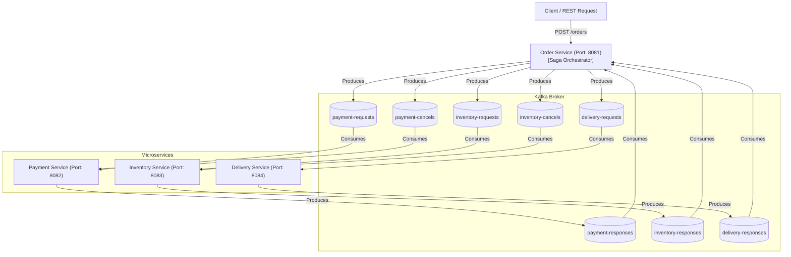
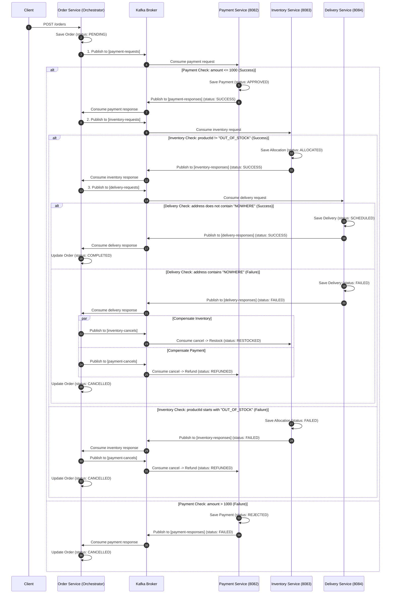

# Saga Pattern (Orchestration) with Spring Boot & Apache Kafka

A production-ready implementation of the **Saga Orchestration Pattern** for distributed transactions across microservices using **Spring Boot 3**, **Apache Kafka**, and **MySQL**.

---

## 1. Project Overview

In microservices architectures, each service has its own dedicated database. When a business workflow spans multiple services (such as creating an order, processing payment, reserving inventory, and scheduling delivery), traditional ACID transactions do not work across database boundaries.

The **Saga Pattern** manages distributed transactions through a sequence of local transactions coordinated via domain events.

### Why Orchestration?
* **Centralized Coordination:** A dedicated orchestrator (`order-service`) directs the entire workflow, deciding what step to execute next and when to trigger compensation (rollback).
* **Clear Workflow Visibility:** The state machine and sequence of steps are defined in one place rather than being distributed across peer services.
* **Dedicated Topics:** Requests, responses, and cancellation commands are separated into dedicated Kafka topics.

---

## 2. Architecture & Service Breakdown

### Architecture Diagram



### Microservices Details

| Service | Port | Database Table | Kafka Topics Used | Role |
| :--- | :--- | :--- | :--- | :--- |
| **`order-service`** | `8081` | `orders` | Produces: `payment-requests`, `inventory-requests`, `delivery-requests`, `payment-cancels`, `inventory-cancels`<br/>Consumes: `payment-responses`, `inventory-responses`, `delivery-responses` | **Saga Orchestrator**: Coordinates all steps and triggers rollbacks |
| **`payment-service`** | `8082` | `payments` | Consumes: `payment-requests`, `payment-cancels`<br/>Produces: `payment-responses` | Participant: Charges payment and performs refunds |
| **`inventory-service`** | `8083` | `inventory_allocations` | Consumes: `inventory-requests`, `inventory-cancels`<br/>Produces: `inventory-responses` | Participant: Allocates inventory and performs restocks |
| **`delivery-service`** | `8084` | `deliveries` | Consumes: `delivery-requests`<br/>Produces: `delivery-responses` | Participant: Schedules shipments |
| **`common-dtos`** | N/A | Shared Library | Contains request/response/cancel event classes and shared DTOs | Shared Library |

---

## 3. Business Logic & Threshold Rules

The mock business logic contains specific conditions designed to test both happy paths and failure/rollback scenarios:

| Service | Condition / Rule | Success Action | Failure / Compensation Action |
| :--- | :--- | :--- | :--- |
| **Payment Service** | `amount <= 1000` | Saves payment as `APPROVED`, publishes `PaymentResponseEvent(SUCCESS)` | Saves payment as `REJECTED`, publishes `PaymentResponseEvent(FAILED)`.<br/>On `PaymentCancelEvent`, updates payment to `REFUNDED`. |
| **Inventory Service** | `productId` does not start with `"OUT_OF_STOCK"` | Saves allocation as `ALLOCATED`, publishes `InventoryResponseEvent(SUCCESS)` | Saves allocation as `FAILED`, publishes `InventoryResponseEvent(FAILED)`.<br/>On `InventoryCancelEvent`, updates allocation to `RESTOCKED`. |
| **Delivery Service** | `address` does not contain `"NOWHERE"` | Saves delivery as `SCHEDULED`, publishes `DeliveryResponseEvent(SUCCESS)` | Saves delivery as `FAILED`, publishes `DeliveryResponseEvent(FAILED)`. |
| **Order Service** | Orchestrator logic | Proceeds to next step on `SUCCESS`. When delivery succeeds, marks order `COMPLETED`. | Cancels order (`CANCELLED`) and sends cancellation events to previously completed participants. |

---

## 4. Sequence Diagram (Orchestration Flow)



---

## 5. Prerequisites

* **Java 17+** (`java -version`)
* **Apache Maven 3.8+** (`mvn -version`)
* **Docker & Docker Compose** (`docker compose version`)

---

## 6. How to Run the Project

### Step 1: Start Kafka, Zookeeper & MySQL
From the `saga-orchestration` directory, start the infrastructure services:
```bash
docker compose up -d
```
* **Kafka**: `localhost:9092`
* **Zookeeper**: `localhost:2181`
* **MySQL**: `localhost:3306` (Database: `saga_db`, User: `root`, Password: `root`)

---

### Step 2: Build the Modules
Build the parent module and all services:
```bash
mvn clean install
```

---

### Step 3: Start the Microservices
Run each service in a separate terminal:

**Terminal 1 — Order Service (Orchestrator, Port 8081):**
```bash
mvn spring-boot:run -pl services/order-service
```

**Terminal 2 — Payment Service (Port 8082):**
```bash
mvn spring-boot:run -pl services/payment-service
```

**Terminal 3 — Inventory Service (Port 8083):**
```bash
mvn spring-boot:run -pl services/inventory-service
```

**Terminal 4 — Delivery Service (Port 8084):**
```bash
mvn spring-boot:run -pl services/delivery-service
```

---

## 7. How to Test the Project

### Test Scenario 1: Happy Path (Successful Order)
* **Conditions:** `amount <= 1000`, `productId` valid, `address` valid.
* **Request:**
  ```bash
  curl -X POST http://localhost:8081/orders \
    -H "Content-Type: application/json" \
    -d '{
      "productId": "PROD-101",
      "quantity": 2,
      "amount": 250.0,
      "address": "123 Baker Street, London"
    }'
  ```
* **Immediate Response:**
  ```json
  {
    "orderId": "<ORDER_ID>",
    "status": "PENDING",
    "message": "Order created, initiating payment..."
  }
  ```
* **Database Verification:**
  ```sql
  SELECT status, message FROM saga_db.orders WHERE id = '<ORDER_ID>';
  -- Result: status = 'COMPLETED', message = 'Order completed successfully.'

  SELECT status FROM saga_db.payments WHERE orderId = '<ORDER_ID>';
  -- Result: status = 'APPROVED'

  SELECT status FROM saga_db.inventory_allocations WHERE orderId = '<ORDER_ID>';
  -- Result: status = 'ALLOCATED'

  SELECT status FROM saga_db.deliveries WHERE orderId = '<ORDER_ID>';
  -- Result: status = 'SCHEDULED'
  ```

---

### Test Scenario 2: Payment Failure
* **Conditions:** `amount > 1000` (e.g., `1500.0`).
* **Request:**
  ```bash
  curl -X POST http://localhost:8081/orders \
    -H "Content-Type: application/json" \
    -d '{
      "productId": "PROD-102",
      "quantity": 1,
      "amount": 1500.0,
      "address": "456 Park Avenue, NY"
    }'
  ```
* **Database Verification:**
  ```sql
  SELECT status, message FROM saga_db.orders WHERE id = '<ORDER_ID>';
  -- Result: status = 'CANCELLED', message = 'Payment failed. Order cancelled.'

  SELECT status FROM saga_db.payments WHERE orderId = '<ORDER_ID>';
  -- Result: status = 'REJECTED'
  ```

---

### Test Scenario 3: Inventory Failure & Payment Compensation (Refund)
* **Conditions:** `amount <= 1000`, but `productId` starts with `"OUT_OF_STOCK"`.
* **Request:**
  ```bash
  curl -X POST http://localhost:8081/orders \
    -H "Content-Type: application/json" \
    -d '{
      "productId": "OUT_OF_STOCK_ITEM",
      "quantity": 2,
      "amount": 500.0,
      "address": "789 Pine Road, Seattle"
    }'
  ```
* **Database Verification:**
  ```sql
  SELECT status, message FROM saga_db.orders WHERE id = '<ORDER_ID>';
  -- Result: status = 'CANCELLED', message = 'Inventory reservation failed. Refunding payment and cancelling order.'

  SELECT status FROM saga_db.payments WHERE orderId = '<ORDER_ID>';
  -- Result: status = 'REFUNDED'  <-- Compensated by Orchestrator!

  SELECT status FROM saga_db.inventory_allocations WHERE orderId = '<ORDER_ID>';
  -- Result: status = 'FAILED'
  ```

---

### Test Scenario 4: Delivery Failure & Full Rollback (Restock + Refund)
* **Conditions:** Valid amount and productId, but `address` contains `"NOWHERE"`.
* **Request:**
  ```bash
  curl -X POST http://localhost:8081/orders \
    -H "Content-Type: application/json" \
    -d '{
      "productId": "PROD-104",
      "quantity": 1,
      "amount": 350.0,
      "address": "NOWHERE City, Sector 404"
    }'
  ```
* **Database Verification:**
  ```sql
  SELECT status, message FROM saga_db.orders WHERE id = '<ORDER_ID>';
  -- Result: status = 'CANCELLED', message = 'Delivery failed. Restocking, refunding, and cancelling order.'

  SELECT status FROM saga_db.payments WHERE orderId = '<ORDER_ID>';
  -- Result: status = 'REFUNDED'  <-- Compensated!

  SELECT status FROM saga_db.inventory_allocations WHERE orderId = '<ORDER_ID>';
  -- Result: status = 'RESTOCKED' <-- Compensated!

  SELECT status FROM saga_db.deliveries WHERE orderId = '<ORDER_ID>';
  -- Result: status = 'FAILED'
  ```

---

## 8. Monitoring & Inspection

### View Kafka Topics Live
You can listen to any topic (e.g. `inventory-cancels` or `payment-responses`) using:
```bash
docker exec -it saga-orchestration-kafka-1 kafka-console-consumer \
  --bootstrap-server localhost:9092 \
  --topic payment-responses \
  --from-beginning
```

