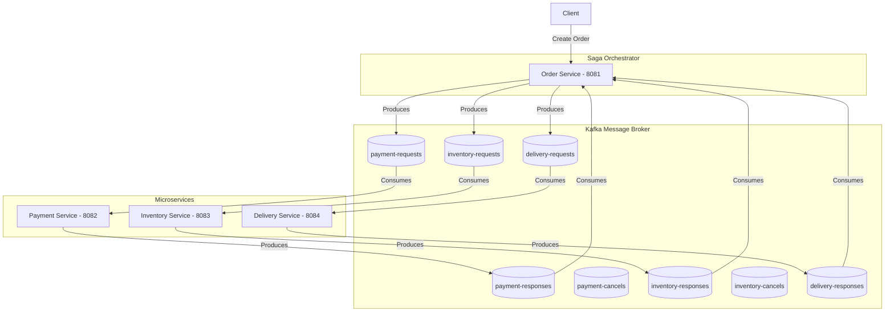
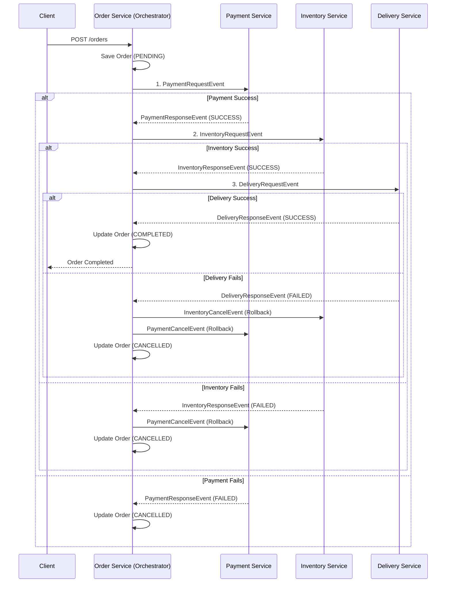
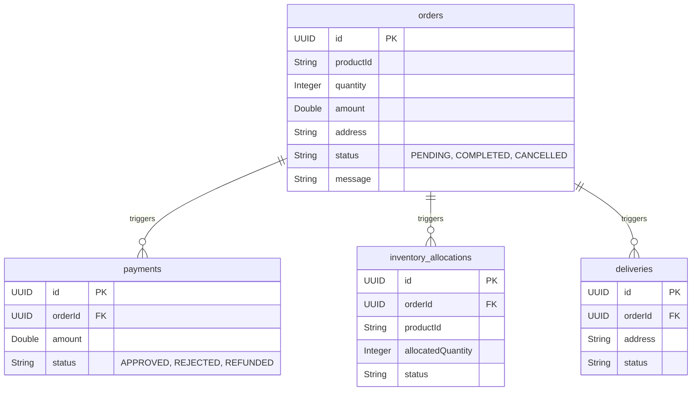
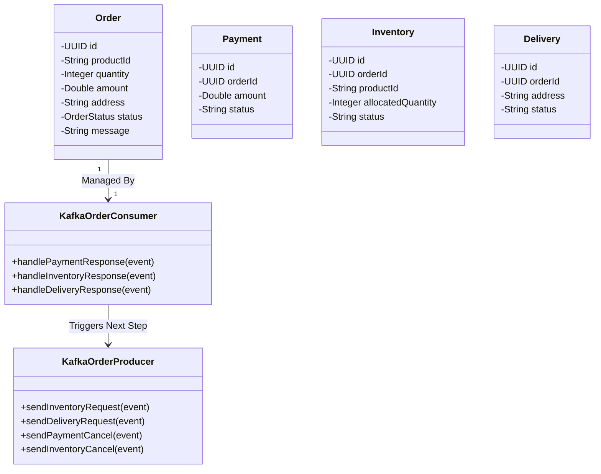

# Saga Orchestration Project Documentation

## 1. Project Overview
This project implements the **Saga Pattern (Orchestration)** using **Apache Kafka** and **Spring Boot** to handle distributed transactions across multiple microservices. 

The system simulates an e-commerce order workflow involving four primary services:
1. **Order Service** (The Central Orchestrator)
2. **Payment Service**
3. **Inventory Service**
4. **Delivery Service**
5. **Common DTOs** (Shared Library)

## 2. Requirements & Business Logic
The system must guarantee data consistency across independent databases without using 2-Phase Commit (2PC) or distributed locks. It uses eventual consistency via compensation transactions.

### Workflow Requirements:
1. When a user creates an order, a payment request is initiated.
2. If payment succeeds, inventory allocation is requested.
3. If inventory allocation succeeds, delivery scheduling is requested.
4. If delivery is scheduled, the order is marked as `COMPLETED`.

### Compensation Requirements (Rollbacks):
1. If **Inventory Allocation fails**: The orchestrator must cancel the order and trigger a `PaymentCancelEvent` to refund the customer.
2. If **Delivery Scheduling fails**: The orchestrator must cancel the order, trigger an `InventoryCancelEvent` to restock the item, and trigger a `PaymentCancelEvent` to refund the customer.

---

## 3. Architecture & Complete Structure

---

## 4. Sequence Diagram (Saga Flow)

---

## 5. Schema Diagram (Database Tables)

*Note: Each microservice has its own isolated database/schema.*

---

## 6. Class Diagram (Core Entities)

